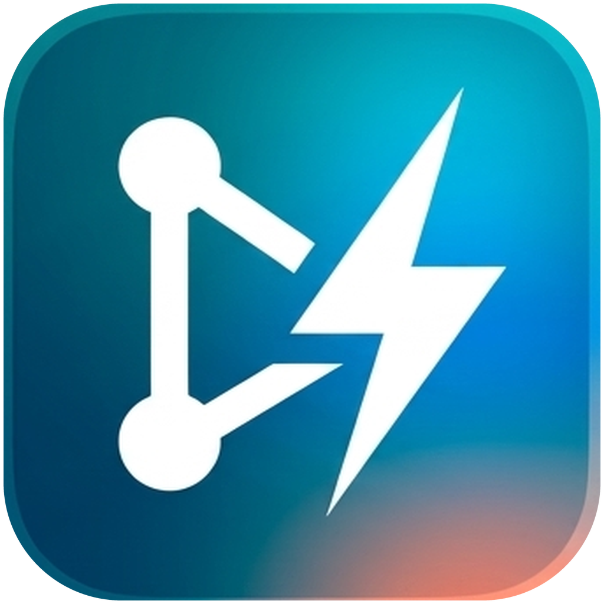

<div align="center">



# Gitfy

**A fast, lightweight desktop Git client with a clear commit graph.**

Browse history, stage changes, review diffs, commit, and sync with your remotes — without leaving one window.


</div>

---

## Table of contents

- [Features](#features)
- [Getting started](#getting-started)
- [Keyboard shortcuts](#keyboard-shortcuts)
- [Working with remotes](#working-with-remotes)
- [Undo / redo](#undo--redo)
- [Architecture](#architecture)
- [Security](#security)
- [Data and storage](#data-and-storage)
- [Roadmap](#roadmap)
- [Troubleshooting and notes](#troubleshooting-and-notes)

## Features

**Repositories**
- Open an existing repository, initialize a new one, or clone from a URL.
- Multi-repository **tabs**. Open tabs are saved and restored on the next launch, and repositories that no longer exist are skipped with a notice.
- Recent repositories list on the welcome screen.

**Commit graph and history**
- Interactive commit graph of all branches as the main view, with virtualized scrolling for large histories.
- Branch, tag and remote badges on commits.
- Commit details panel with author, date, hash and changed files.
- **Commit search** (`Ctrl+F`): matches stay highlighted in the graph, and `Enter` / `Shift+Enter` jump between them.

**Staging and committing**
- Uncommitted changes appear as a `// WIP` row at the top of the graph, with live status.
- Stage and unstage individual files, then commit with a summary and a description.
- Status refreshes every 3 seconds while the window is visible, and immediately on window focus.

**Diff viewer**
- Monaco-powered diffs, **side-by-side or inline**, with syntax highlighting.
- The diff replaces the graph for the full width of the window. Press `Esc` to go back.

**Branches, tags and stashes**
- Refs sidebar listing local branches, remote branches, stashes and tags. Click an entry to jump to its commit.
- Switch, create and delete branches.
- **Add a remote** (such as `origin`) with the **+** button in the sidebar's Remote section. Configured remotes are listed even before their first fetch.

**Remotes**
- Fetch all, pull (fast-forward if possible, or fast-forward only) and push from the toolbar.
- Built-in SSH key management and credential prompts. See [Working with remotes](#working-with-remotes).

**Undo / redo**
- Undo and redo commits, checkouts, branch creation and deletion, and pulls. See [Undo / redo](#undo--redo).

## Getting started

### Requirements

| Tool | Version | Notes |
| --- | --- | --- |
| [Bun](https://bun.com) | 1.4+ | Package manager and script runner |
| Git | 2.23+ | Must be on `PATH` (Gitfy uses `git switch`) |

### Install and run

```bash
bun install      # installs dependencies; the Electron binary is downloaded on first run
bun run dev      # starts Vite and Electron with hot reload
```

### Build

```bash
bun run build:linux   # AppImage (x64)
bun run build:win     # NSIS installer (x64)
bun run build:mac     # DMG (Apple Silicon / arm64)
bun run build:dir     # unpacked build for the current OS, faster for local testing
```

Output goes to `release/<version>/`. See [Build targets](#build-targets) for details.

### Scripts

| Command | Description |
| --- | --- |
| `bun run dev` | Start Vite + Electron with hot reload |
| `bun run typecheck` | Type-check main, preload and renderer |
| `bun run build` | Type-check, bundle and package for the current OS |
| `bun run build:linux` | Package an AppImage |
| `bun run build:win` | Package a Windows x64 installer |
| `bun run build:mac` | Package a macOS arm64 DMG |
| `bun run build:dir` | Same as `build`, but unpacked |

> `bun.lock` is the only lockfile. Do not commit a `package-lock.json`.

### Build targets

Configured in [`electron-builder.yml`](electron-builder.yml).

| OS | Architecture | Format | Artifact | Test status |
| --- | --- | --- | --- | --- |
| Linux | x64 | AppImage | `Gitfy-<version>.AppImage` | Tested on Debian / Ubuntu only |
| Windows | x64 | NSIS installer | `Gitfy-<version>-win-x64.exe` | Not tested |
| macOS | Apple Silicon (`arm64`) | DMG | `Gitfy-<version>-mac-arm64.dmg` | Not tested |

- Build each target on its own OS where possible. DMG can only be built on macOS, and Windows builds from Linux need Wine. A CI matrix (`ubuntu-latest`, `windows-latest`, `macos-latest`) is the simplest route.
- Release builds are **not code-signed** yet. Windows SmartScreen will warn, and macOS Gatekeeper will block the app on other machines until it is signed and notarized.
- **Platform support:** Linux has so far been tested only on Debian / Ubuntu. Other distributions (Fedora, Arch…) are untested. The Windows and macOS targets are configured but have not been tested at all. The askpass helper uses a unix socket and may need a named-pipe equivalent on Windows.

## Keyboard shortcuts

| Shortcut | Action |
| --- | --- |
| `Ctrl+T` | New tab |
| `Ctrl+Tab` | Cycle through tabs |
| Middle-click on a tab | Close tab |
| `Ctrl+F` | Search commits |
| `Enter` / `Shift+Enter` | Next / previous search match |
| `Esc` | Close the diff and return to the graph |

## Working with remotes

Network commands (fetch, pull, push, clone) run without a terminal, so they never hang on an invisible prompt.

- **SSH:** configure it under **Preferences → SSH** (the ⚙ icon in the header, or on the welcome screen).
  - Use the system `ssh-agent`, or pick an existing key, or generate a new ED25519 key. Generated keys are stored in Gitfy's data folder, and `~/.ssh` is never modified.
  - Copy the public key and test the connection to GitHub, GitLab or Bitbucket.
  - New hosts are accepted on first use. Changed host keys are rejected.
- **Passphrases and HTTPS credentials:** when ssh needs a key passphrase, or git needs an HTTPS username and password, Gitfy shows a dialog through its own `SSH_ASKPASS` helper. Answers can be remembered in memory for the session and are never written to disk.
- **Timeouts:** a command is aborted after 2 minutes without output.

## Undo / redo

The header toolbar reads **Undo · Redo · Pull · Push · Branch**. The Pull menu offers *Fetch All*, *Pull (fast-forward if possible)* and *Pull (fast-forward only)*.

Operations made through Gitfy are recorded per repository and can be undone and redone:

- commit
- branch checkout, including fast-forward
- create and delete branch
- pull

Safety rules:

- Each undo or redo first checks that the repository is still exactly as the operation left it. It refuses otherwise, for example after commits made in a terminal.
- Pushing clears the history, because pushed commits are shared.

## Architecture

```
electron/                 Main process (Node) — the only place that touches git or the filesystem
  main.ts                 Window, CSP, IPC handler registration
  preload.ts              contextBridge API exposed as window.gitfy
  services/
    repo.service.ts       Current repo, recent list, open / init / clone
    git.service.ts        status, stage / unstage, diff, commit, log, branches, remotes
    history.service.ts    Per-repository undo / redo history
    settings.service.ts   Global preferences (SSH) stored in settings.json
    askpass.service.ts    SSH_ASKPASS helper over a private unix socket
    net.ts                Network command environment and timeouts
src/                      Renderer (React)
  types/git.ts            Types shared by main and renderer
  services/ipc.ts         Typed client around window.gitfy (unwraps IpcResult)
  store/                  Zustand stores (repo, UI, toasts)
  features/
    repo/                 Welcome screen, clone dialog
    commit/               Commit graph, graph layout, ref badges, detail panel, search, commit form
    staging/              WIP panel (unstaged / staged files), file lists
    diff/                 Full-width diff shown in place of the graph
    branch/               Refs sidebar, create / delete dialogs
    settings/             Preferences, SSH settings
  components/             Shared UI (Button, Modal, Toaster, DiffViewer, Icon…)
  layouts/                AppLayout, Header, TabBar, Sidebar
electron-builder.yml      Packaging targets: Linux AppImage x64, Windows NSIS x64, macOS DMG arm64
```

**Tech stack:** Electron, React, TypeScript, Tailwind CSS, Zustand, [`simple-git`](https://github.com/steveukx/git-js) as the Git engine, Monaco Editor for diffs, TanStack Virtual for the graph, and Vite with `electron-builder` for build and packaging.

The Electron main process runs on Electron's bundled Node.js, not on Bun. Code in `electron/` must therefore use Node APIs only (no `Bun.*`).

## Security

- `contextIsolation` is on, `nodeIntegration` is off, and the renderer is sandboxed.
- The renderer has no filesystem access. It talks to the main process only through the typed `window.gitfy` bridge.
- Git commands take the tab's repository path, but the main process accepts only repositories opened through open / init / clone, and forgets them when the tab closes.
- Every file path is validated to stay inside the repository.
- IPC handlers return `{ ok, data } | { ok, error }` instead of throwing across the bridge.
- Credentials are never persisted. Askpass answers live in memory for the session only.

## Data and storage

Application state in the renderer lives in memory and starts empty on every launch. Persistent data (recent repositories, open tabs, preferences) is stored in the user data folder:

| Build | Location |
| --- | --- |
| Linux, release | `~/.config/Gitfy` |
| Linux, development (`bun run dev`) | `~/.config/Gitfy-dev` |
| Windows, release | `%APPDATA%\Gitfy` |
| macOS, release | `~/Library/Application Support/Gitfy` |

Development data is kept separate so it never leaks into a release.

## Roadmap

- [x] **Sprint 1:** project setup, secure IPC, base layout
- [x] **Sprint 2:** open / init / clone, real-time status, stage / unstage, Monaco diff (split / inline)
- [x] **Sprint 3:** commit (summary + description), history with commit graph and per-commit diffs, branch list / switch / create / delete
- [x] **Remotes and history:** fetch / pull / push, undo / redo, SSH preferences, multi-repository tabs, commit search
- [ ] **Sprint 4:** conflicts and release polish
  - Merge-conflict UI built on `status().conflicted`, with ours / theirs / manual resolution
  - `merge()` / `mergeFromTo()` with abort, and conflict detection after pull
  - Error polish and manual "Check for updates"
- [ ] **Sprint 5:** stash and tags
  - Stash: `stash(['push', '-u'])`, `stash(['apply'])`, `stash(['pop'])`, `stash(['drop'])` (the sidebar currently lists stashes only)
  - Tags: `addTag()`, `addAnnotatedTag()`, `tags()`, delete, and push tags
  - Discard changes: `checkout(['--', file])` and `clean()` for untracked files, always behind a confirmation
- [ ] **Sprint 6:** history rewriting
  - `rebase()` with abort / continue (interactive rebase is later)
  - Cherry-pick and revert from the commit panel (`raw(['cherry-pick'])`, `revert()`)
  - `reset()` soft / mixed / hard to a chosen commit
  - Amend the last commit (`commit(msg, { '--amend': null })`)
  - Undo / redo support for the new operations
- [ ] **Sprint 7:** deeper inspection
  - File history and blame (`log({ file })`, `raw(['blame', '--porcelain'])`)
  - Hunk- and line-level staging via `applyPatch()`
  - `diffSummary()` stats in the commit panel
  - Branch compare, and filter the graph by branch or author
- [ ] **Sprint 8:** remotes and repository management
  - Add, rename and remove remotes (`addRemote()`, `removeRemote()`, `getRemotes(true)`)
  - Push options: set upstream, `--force-with-lease`, push tags
  - Pull with rebase (`pull('origin', branch, { '--rebase': null })`) and prune on fetch
  - Submodules (`subModule()`, `submoduleUpdate()`) and Git LFS detection
  - Per-repository settings: user name / email (`addConfig()`, `listConfig()`), `.gitignore` editor via `checkIgnore()`
- [ ] **Later:** code signing and CI release pipeline for Windows / macOS, verify Windows / macOS behavior (askpass, SSH), light / dark theme switch, command palette, GitHub / GitLab pull-request links

Planned git operations use the [`simple-git`](https://github.com/steveukx/git-js) API, with `raw()` as a fallback for commands it has no helper for. The full product spec is in [`PRD GitFy.txt`](PRD%20GitFy.txt). Updates will be manual, with no silent background auto-update.

## Troubleshooting and notes

- **`bun run dev` starts Electron as plain Node:** `vite.config.mts` clears `ELECTRON_RUN_AS_NODE`, which VS Code sets in some child processes. If you still hit this, unset it in your shell.
- **Pull or push fails with an authentication error:** check **Preferences → SSH** and use *Test connection*. For HTTPS remotes, Gitfy will prompt for credentials.
- **Undo is refused:** the repository changed outside Gitfy after the recorded operation, so Gitfy will not rewrite it.

---

<div align="center">

Built by Setyo Purnomo · <a href="mailto:sangvictim@gmail.com">sangvictim@gmail.com</a>

</div>
